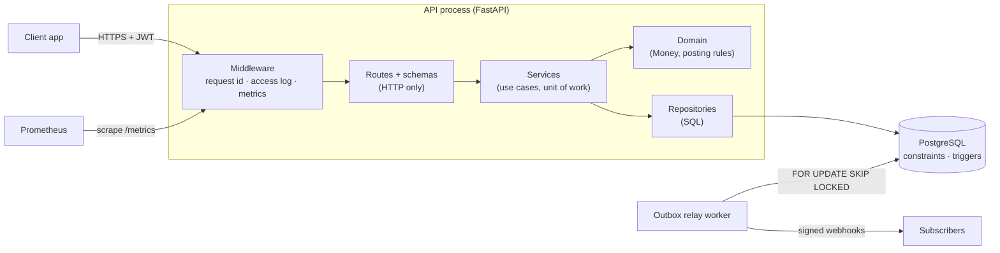
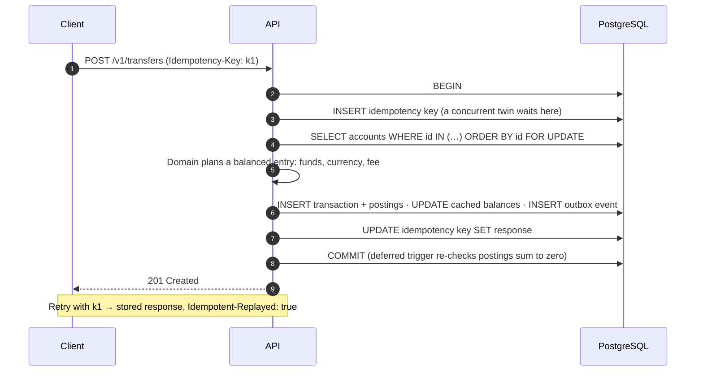
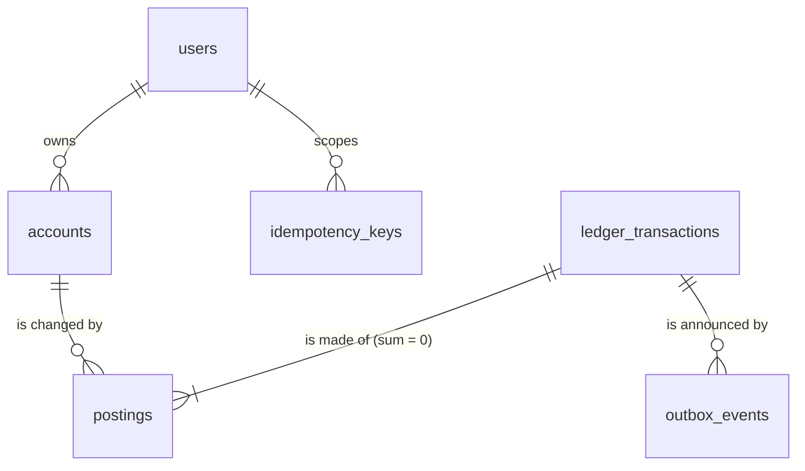

# Ledgerline

[](https://github.com/Abdulrahman-Zaghloul/ledgerline/actions/workflows/ci.yml)


**A double-entry wallet and payments ledger API with idempotent, concurrency-safe money movement.**

Ledgerline is the kind of service that sits behind a P2P payments app: users hold
multi-currency wallets, deposit, withdraw and send money to each other. The interesting
part is not the CRUD. It's the guarantees: money is never created, lost or spent twice,
even under concurrent requests, client retries, crashes and bugs in application code.

---

## Highlights

| Problem | How Ledgerline solves it | Where |
| --- | --- | --- |
| Money appearing or vanishing | Double-entry bookkeeping: every transaction's postings sum to zero, verified by a **deferred constraint trigger** at commit | [`domain/ledger.py`](src/ledger/domain/ledger.py), [migration](migrations/versions/0001_initial_schema.py) |
| Silent edits to history | Ledger tables are **append-only**, enforced by database triggers | [migration](migrations/versions/0001_initial_schema.py) |
| Double-spending under concurrency | `SELECT … FOR UPDATE` with **globally ordered lock acquisition** (no deadlocks); verified by parallel tests that fail when the lock is removed | [`repositories/accounts.py`](src/ledger/repositories/accounts.py), [`test_concurrency.py`](tests/integration/test_concurrency.py) |
| Duplicate charges from retries | Mandatory **`Idempotency-Key`**; key, money movement and response commit in **one transaction** | [`services/idempotency.py`](src/ledger/services/idempotency.py) |
| Lost or phantom events | **Transactional outbox** + relay with `SKIP LOCKED`, exponential backoff with jitter, dead-lettering, **HMAC-signed webhooks** | [`workers/outbox_relay.py`](src/ledger/workers/outbox_relay.py) |
| Floating-point money bugs | Integer minor units only; fees use exact integer **banker's rounding** | [`domain/money.py`](src/ledger/domain/money.py) |
| Lock hot-spots on platform accounts | System accounts keep no cached balance, so they are never locked | [ADR 0006](docs/adr/0006-system-accounts-without-cached-balances.md) |
| Drift between cache and truth | Independent **reconciliation** (`ledgerline reconcile`) checks every balance against postings | [`services/reconciliation.py`](src/ledger/services/reconciliation.py) |

Also: Argon2id password hashing, JWTs with pinned algorithm/audience/issuer, timing-safe login,
`404`-not-`403` for other users' resources, token-bucket rate limiting, RFC 9457 problem
responses, JSON logs with request IDs, Prometheus metrics with bounded label cardinality,
liveness/readiness probes, strict `mypy`, `ruff`, migrations verified against models in CI,
and a multi-stage non-root Docker image.

## Architecture



Dependencies point inward. The **domain** package imports nothing from FastAPI or
SQLAlchemy, so every business rule is unit-tested in milliseconds without a database.
**Services** own use cases but never commit; the caller (request handler, CLI, worker)
decides the transaction boundary, which is what lets the idempotency key and the money
movement commit atomically.

| Layer | Responsibility | Knows about |
| --- | --- | --- |
| `api/` | HTTP: routing, validation, auth, error mapping, rate limits | services, schemas |
| `services/` | Use cases: deposit, transfer, idempotent execution, reconciliation | domain, repositories |
| `domain/` | Pure rules: `Money`, journal entries, funds and currency checks | nothing |
| `repositories/` | Queries and locking, one class per table | ORM models |
| `db/` | ORM models, engine, sessions | SQLAlchemy |
| `workers/` | Outbox relay, key purging | services, repositories |

### Life of a transfer



### Data model



Invariants the **database** enforces, independent of application code:

- Postings of a transaction sum to zero per currency (deferred constraint trigger).
- `postings` and `ledger_transactions` reject `UPDATE`/`DELETE` (append-only triggers).
- A posting's currency equals its account's currency (composite foreign key).
- User balances are never negative; system accounts carry no cached balance (`CHECK`s).

## Design decisions

Each significant decision is recorded as an [Architecture Decision Record](docs/adr/):

1. [Double-entry ledger with append-only postings](docs/adr/0001-double-entry-ledger.md)
2. [Money as integer minor units](docs/adr/0002-money-as-integer-minor-units.md)
3. [Pessimistic row locks with ordered acquisition](docs/adr/0003-pessimistic-locking-with-ordered-acquisition.md)
4. [Idempotency keys committed with the operation](docs/adr/0004-idempotency-keys-in-the-same-transaction.md)
5. [Transactional outbox for events](docs/adr/0005-transactional-outbox.md)
6. [System accounts without cached balances](docs/adr/0006-system-accounts-without-cached-balances.md)
7. [Synchronous SQLAlchemy over async](docs/adr/0007-synchronous-sqlalchemy.md)

## Getting started

### With Docker (recommended)

```bash
docker compose up --build
# API docs: http://localhost:8000/docs
```

This starts PostgreSQL, runs migrations as a one-shot job, then starts the API and the
outbox relay.

### Locally

Requires Python 3.12+ and PostgreSQL 16 (`make db` starts one in Docker).

```bash
python -m venv .venv && source .venv/bin/activate
make install          # app + dev tools
cp .env.example .env  # adjust if needed
make migrate          # create the schema
make run              # http://localhost:8000/docs
make relay            # (optional, second terminal) deliver events
```

## API walkthrough

```bash
API=http://localhost:8000
json='content-type: application/json'

curl -s -X POST $API/v1/auth/register -H "$json" \
  -d '{"email":"alice@example.com","password":"correct horse battery"}'
TOKEN=$(curl -s -X POST $API/v1/auth/token -H "$json" \
  -d '{"email":"alice@example.com","password":"correct horse battery"}' | jq -r .access_token)
AUTH="authorization: Bearer $TOKEN"

WALLET=$(curl -s -X POST $API/v1/accounts -H "$AUTH" -H "$json" \
  -d '{"name":"Everyday","currency":"USD"}' | jq -r .id)

# Amounts are integer minor units: 10000 = $100.00.
# Any unique string works as the key; send the same request again and nothing moves twice.
curl -s -X POST $API/v1/deposits -H "$AUTH" -H "$json" -H "Idempotency-Key: first-deposit" \
  -d "{\"account_id\":\"$WALLET\",\"amount\":10000}"

curl -s $API/v1/accounts/$WALLET -H "$AUTH"
# {"id":"…","name":"Everyday","currency":"USD","balance":10000,"balance_display":"100.00 USD",…}
```

Errors use [RFC 9457](https://www.rfc-editor.org/rfc/rfc9457) problem details:

```json
{
  "type": "/problems/insufficient-funds",
  "title": "Insufficient funds",
  "status": 422,
  "detail": "Account 5cac… has 74.88 USD; 10049.99 USD is required",
  "instance": "/v1/transfers",
  "request_id": "5780208657db406db16100d33268135a"
}
```

| Endpoint | Purpose |
| --- | --- |
| `POST /v1/auth/register` · `POST /v1/auth/token` · `GET /v1/me` | Users and tokens |
| `POST /v1/accounts` · `GET /v1/accounts` · `GET /v1/accounts/{id}` | Wallets and balances |
| `GET /v1/accounts/{id}/statement?limit&cursor` | Keyset-paginated history |
| `POST /v1/deposits` · `POST /v1/withdrawals` · `POST /v1/transfers` | Money movement (idempotent, rate limited) |
| `GET /v1/transactions/{id}` | A transaction visible to either party |
| `GET /health/live` · `GET /health/ready` · `GET /metrics` | Operations |

## Testing

```bash
make test    # full suite (needs PostgreSQL; see LEDGER_TEST_DATABASE_URL)
make check   # lint + types + tests with the 90% coverage gate, exactly as CI runs it
```

- **Unit tests** cover `Money`, rounding, posting rules and the rate limiter with no I/O.
- **Integration tests** run against real PostgreSQL. The schema is built by running the
  Alembic migrations down and up, so every run also tests the migrations.
- **Concurrency tests** release 10–40 threads at once through a barrier: parallel
  withdrawals never overdraw, opposing transfers never deadlock, and concurrent retries of
  one idempotency key move money exactly once. These were verified by removing the row
  lock: the overdraft test then fails (20 of 20 withdrawals succeed on a balance for 10).
- **Database invariant tests** bypass the application and prove the schema itself rejects
  unbalanced, edited or cross-currency postings.

## Observability

- **Logs:** one JSON line per request with `request_id`, method, route, status and
  latency. Clients may send `X-Request-ID`; it is echoed back and included in error bodies.
- **Metrics** at `/metrics`: `ledger_http_requests_total`, `ledger_http_request_duration_seconds`,
  `ledger_transactions_total{kind}`, `ledger_idempotent_replays_total`, `ledger_outbox_events_total{outcome}`.
  Labels use route templates, and unmatched paths collapse to one label, so cardinality stays bounded.
- **Probes:** `/health/live` (process up) and `/health/ready` (database reachable).
- **Books:** `ledgerline reconcile` exits non-zero on any drift, so it can run as a scheduled job and alert.

## Security

- Argon2id password hashing with transparent re-hashing when parameters change.
- Login takes the same time whether or not the email exists, so it cannot be used to enumerate accounts.
- JWTs pin `HS256`, and require `exp`, `iat`, `iss`, `aud` and `sub`. The app refuses to start in production with the development secret.
- Authorization by ownership. Other users' resources return `404`, so their existence is not revealed.
- Strict request schemas (`extra="forbid"`, strict integers, length limits) and separate login and API rate limits.
- Webhooks are HMAC-SHA256 signed; receivers verify with a constant-time comparison.
- The container runs as an unprivileged user; secrets come only from the environment.

## Trade-offs and next steps

What I would change for larger scale, and why it isn't here yet:

- **Distributed rate limiting.** The token bucket is in-process, which is correct for one
  instance. Running several replicas would move it to Redis.
- **Hot user wallets.** A single wallet receiving thousands of transfers per second
  serialises on its row lock. Fixes include splitting it into sub-accounts or batching
  credits asynchronously.
- **Event streaming.** The relay posts webhooks. A Kafka or SNS publisher fits behind the
  same `Publisher` protocol, or change-data-capture (Debezium) could replace polling.
- **Ledger features.** Holds/authorizations (two-phase), reversals as compensating
  transactions, and FX through conversion accounts.
- **Auth for many services.** Asymmetric keys (EdDSA/RS256) published through JWKS, plus
  refresh tokens and revocation via the `jti` claim.
- **Tracing.** OpenTelemetry spans that propagate the existing request ID.
- **Data growth.** Time-partition `postings`, and serve statements from a read replica.

## Project structure

```
src/ledger/
├── api/            # FastAPI routes, schemas, deps, errors, middleware, rate limiting
├── domain/         # Money, posting rules, errors — no framework imports
├── services/       # auth, accounts, payments, idempotency, reconciliation, pagination
├── repositories/   # one class per table; locking lives here
├── db/             # SQLAlchemy models and session factory
├── workers/        # outbox relay
├── observability/  # JSON logging, Prometheus metrics
├── cli.py          # ledgerline seed | reconcile | relay
└── main.py         # application factory
migrations/         # Alembic, including ledger triggers
tests/unit/         # fast, no I/O
tests/integration/  # real PostgreSQL, concurrency, invariants
docs/adr/           # architecture decision records
```

## License

[MIT](LICENSE)
